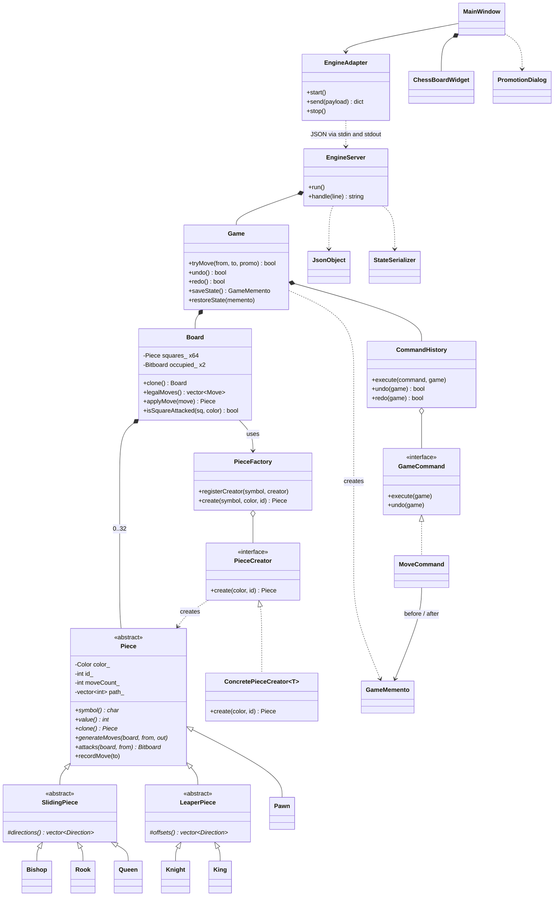
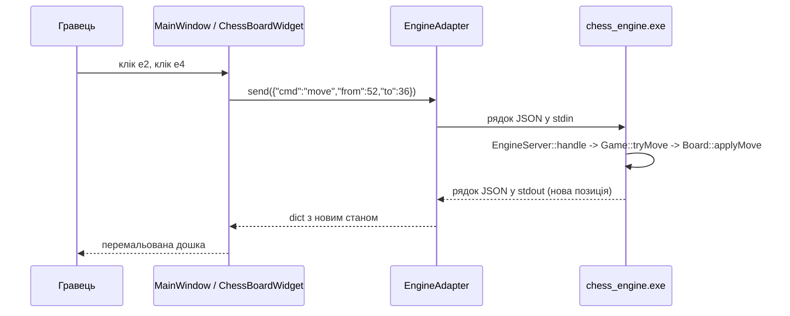

# Шахи з казковими фігурами (Roguelike Chess)
Курсовий проєкт з дисципліни «Об'єктно-орієнтоване програмування», тема M-05 «Chess with Fairy Pieces / Custom Mechanics».

## Інформація про автора
- **Студент:** Болотський Максим Сергійович
- **Група:** ОІ-23
- **Навчальний заклад:** Національний університет «Львівська політехніка»
- **Керівник:** асистент кафедри АСУ Черкас Н. С.

## Ідея гри
Партія починається зі стандартного набору фігур. Під час гри кожна фігура окремо «прокачується»: за кількість зроблених ходів або за очки взятих фігур вона отримує бонуси (у кожного типу фігур по 3 бонуси, вони накопичуються). Правила однакові для білих і чорних. Режими: «людина — людина» (hotseat) і «людина — комп'ютер» (у розробці). Інтерфейс гри англійською мовою.

## Поточний стан
**Реалізовано:**
- повні правила класичних шахів: усі ходи фігур, рокіровка, взяття на проході, перетворення пішака з вибором фігури;
- шах, мат, пат, нічия через триразове повторення позиції та правило 50 ходів;
- Undo / Redo;
- графічний інтерфейс: підсвітка можливих ходів, останнього ходу та шаху, історія в шаховій нотації, взяті фігури й матеріал, інформація про будь-яку фігуру за кліком (id, кількість ходів, шлях);
- тести рушія (`run.bat test`).

**Далі:** система бонусів (Decorator), фази ходу (State), вікно Buff Draft, режим «людина — комп'ютер» (бот).

## Система бафів (у розробці)

### Загальні правила
- Кожен тип фігури має пул із 3 бафів. Коли фігура виконує умову, гравець бачить усі бафи, що лишились у її пулі, і вибирає один (**Buff Draft**). Бафи накопичуються.
- **Умова за ходами:** вибір бафу одразу в кінці ходу. **Умова за очками взяття:** на початку наступного ходу гравця (якщо фігура жива). Обидві умови одним ходом дають 2 бафи. Максимум 1 баф за взяття за хід, надлишок очок переноситься.
- **Цінність фігур:** пішак 1, кінь 3, слон 4, тура 5, ферзь 9.
- Додаткові ходи й Develop Queen у лічильник ходів не йдуть; рокіровка й обмін короля з турою дають +1 обом фігурам.
- Додатковий хід робить та фігура, що має баф. Короля не можна взяти — тільки мат. Кожен хід, зокрема додатковий, має лишати свого короля не під шахом.
- При перетворенні пішака його бафи й лічильники зникають: це нова «чиста» фігура.
- **Воскресіння** (кінь, ферзь): фігура повертається на останнє поле зі своєї історії, яке порожнє і з якого вона не дає шаху. Якщо такого немає — ставиться на будь-яке порожнє поле, але власник пропускає хід.

| Фігура | Умова за ходами | Умова за очками |
|---|---|---|
| Пішак | кожні 3 ходи | кожне взяття |
| Кінь | кожні 5 ходів | кожні 3 очки |
| Слон | кожні 5 ходів | кожні 4 очки |
| Тура | кожні 4 ходи | кожні 4 очки |
| Ферзь | кожні 5 ходів | кожні 5 очок |
| Король | кожні 3 ходи | кожне взяття |

### Пішак
| Баф | Що робить |
|---|---|
| **Alekhine's Gun** | Б'є на 1 поле прямо вперед. Разом з Bongcloud «лікує» пацифізм: пішак ходить і б'є в усі 8 боків, як король. |
| **Glad I didn't overcommit** | При взятті гравець вибирає: стати на поле взятої фігури чи лишитися на місці. |
| **Bongcloud** | Ходить на 1 поле в будь-який бік без взяття і міняється місцями із сусіднім своїм пішаком. Не відступає на свою 1-шу горизонталь; з 2-ї знову може піти на 2 поля; перетворюється при будь-якому ході на останню горизонталь. |

### Слон
| Баф | Що робить |
|---|---|
| **Let's get that bishop moving** | Взяття дає +1 додатковий хід (раз за хід). |
| **Setup Bishop** | Шах дає +1 додатковий хід (раз за хід). На полі, з якого дано шах, лишається фантом: тримає шах і блокує лінії до кінця наступного ходу. Взяли фантома чи слона — зникають обидва. |
| **I'll cover my angles** | Ходить і б'є на 1 поле по прямій (може змінити колір поля). |

### Кінь
| Баф | Що робить |
|---|---|
| **Kingside Knight** | Якщо стрибок проходить над будь-якою фігурою — +1 додатковий хід (раз за хід). |
| **Everyone deserves protection** | Після взяття кінь воскресає. Баф витрачається і повертається в пул. |
| **I like to wait for my opponent to make a mistake** | Знищує всі ворожі фігури, над якими перестрибнув (крім короля). Будь-яке взяття — +1 додатковий хід (раз за хід). |

### Тура
| Баф | Що робить |
|---|---|
| **Queen almost ready** | Тура стає ферзем, зберігає свої бафи тури, а решта пулу замінюється бафами ферзя. |
| **They won't expect this** | Створює пішака-привида (при отриманні бафу, кожному наступному бафі, рокіровці, телепорті). Максимум 5 привидів. Тура з цим бафом проходить крізь своїх привидів. |
| **Sendin' castle** | Одноразовий телепорт на поле поруч зі своїм королем, не витрачаючи хід. |

### Ферзь
| Баф | Що робить |
|---|---|
| **Develop Queen** | Перед ходом — телепорт на випадкове порожнє поле, яке б'є ферзь (без шаху), потім звичайний хід. |
| **Ready to promote queen** | На початку ходу кидок d12 — ферзь отримує на цей хід послаблену копію бафу іншої фігури (таблиця нижче). |
| **Checkmate** | Усі кидки ферзя подвоюються: 2 ефекти за хід, 2 телепорти Develop Queen. |

**Ефекти d12** (кожен — послаблена копія бафу іншої фігури):
| d12 | Ефект |
|---|---|
| 1, 6 | Ходи коня + «ліки» від ефекту 3 |
| 2 | Бити сусідню фігуру, не рухаючись |
| 3 | Телепорт на будь-яке порожнє поле (кінець ходу, без взяття) або звичайний хід без взяття |
| 4 | Шах ферзем дає +1 додатковий хід |
| 5 | Взяття ферзем дає +1 додатковий хід з половинною дальністю |
| 7, 9 | Під час руху можна перестрибнути 1 фігуру (обидва разом — 2) |
| 8 | Якщо ферзя візьмуть, вона воскресає через 1 хід |
| 10 | Поодинці нічого; з другим кубиком запам'ятовує другий ефект назавжди |
| 11 | Створює звичайного пішака біля ферзя (з ефектом 10 — двох) |
| 12 | Телепорт поруч зі своїм королем, після чого ферзь ще ходить |

### Король
| Баф | Що робить |
|---|---|
| **They almost had me** | Міняється місцями з будь-якою своєю турою на будь-якій відстані (з кожною турою раз за гру, не під шахом і не під шах). |
| **Almost had 'em** | Може стати поруч із ворожим королем, даючи йому шах. Якщо цей баф є в обох — вони просто можуть стояти поруч. |
| **I can improve some abilities** | +1 додатковий хід королем за кожну свою фігуру, яка одночасно мала 3 бафи (максимум +4). |

## Структура проєкту
```
cpp_engine/
  Types.h               Color, Square, Move, Bitboard
  Piece.h/.cpp          ієрархія фігур (Piece -> SlidingPiece / LeaperPiece -> Bishop, Rook, ...)
  PieceFactory.h/.cpp   створення фігур (Factory Method + реєстр)
  Board.h/.cpp          дошка: об'єкти фігур + bitboard-кеш, генерація легальних ходів
  Game.h/.cpp           партія: статус, нотація, повторення, Undo/Redo (Command + Memento)
  Json.h/.cpp           розбір запитів
  EngineServer.h/.cpp   протокол stdin/stdout, серіалізація стану
  main.cpp              точка входу, з'єднання конкретних класів
  tests/engine_tests.cpp
python_ui/
  main.py               головне вікно
  board_widget.py       малювання дошки та обробка кліків
  engine_adapter.py     зв'язок з рушієм (Adapter)
  promotion_dialog.py   вибір фігури при перетворенні пішака
  demo_ipc.py           демонстрація обміну C++ <-> Python
  Pieces/               SVG-фігури
```

## Архітектура
Усі правила гри знаходяться в C++-рушії. Python-інтерфейс лише показує стан і передає кліки. Процеси обмінюються JSON-рядками через `stdin` / `stdout`, одна відповідь на кожен запит (докладніше — у розділі «Виклик C++ ↔ Python»).
Команди: `new_game`, `state`, `move`, `undo`, `redo`, `load_fen`, `quit`. Помилки повертаються як `{"status":"error","message":"..."}`.

Клітинки нумеруються від 0 (a8) до 63 (h1).

### Бітборди і чому дошка гібридна
**Що таке бітборд.** На дошці 64 клітинки, а в числі `uint64_t` — 64 біти. Тож одне число може зберігати відповідь «так/ні» для кожної клітинки одразу: наприклад, «тут стоїть білий кінь» (біт = 1) чи ні (біт = 0). Сильні шахові рушії, як-от Stockfish, зберігають позицію як 12 таких чисел (по одному на кожен тип фігури кожного кольору).

**Чому це швидко.** Одна операція процесора обробляє одразу всі 64 клітинки. Наприклад, хід усіх пішаків на клітинку вперед — це один зсув числа замість циклу по дошці. Тому рушій на бітбордах перебирає позиції набагато швидше, а для сильного бота це важливо.

**Проблема в моїй грі.** Бітборд знає лише, *що* на клітинці стоїть білий кінь, але не знає, *який саме*. А в мене кожна фігура має власний стан: лічильник ходів, історію шляху і власні бафи. Кінь, що знищує фігури стрибком, ходить інакше, ніж звичайний кінь. Описати це лише бітбордами не вийде: довелося б заводити окреме число на кожну комбінацію бафів, а бафи накопичуються, тож комбінацій забагато.

**Рішення — гібрид.**
- **Основа — об'єкти фігур** (масив із 64 клітинок). Кожна фігура сама знає свій стан і свої ходи — це й дає поліморфізм і місце для бафів.
- **Бітборди — як швидкий помічник поруч:** дві маски «де стоять білі» і «де стоять чорні» для миттєвих перевірок «чи порожня клітинка» та «чи там ворог», а також маски атакованих полів для перевірки шаху.

Так рушій працює повільніше, ніж «чистий» бітбордний, але для гри людина проти людини різниці не видно: ходи рахуються за частки мілісекунди.

## Діаграма класів

Верхня частина — C++-рушій, нижня (`EngineAdapter`, `MainWindow`, `ChessBoardWidget`, `PromotionDialog`) — Python-інтерфейс.

## Обрані патерни та обґрунтування
| Патерн | Де в коді | Чому саме він |
|---|---|---|
| **Template Method** | `SlidingPiece`, `LeaperPiece` | Слон, тура й ферзь рухаються за одним алгоритмом («ковзай у напрямку до першої фігури»), а кінь і король — за іншим («стрибни на фіксований зсув»). Алгоритм написаний один раз у батьківському класі, нащадки задають лише свої напрямки. Без дублювання коду. |
| **Prototype** (породжувальний) | `Piece::clone()`, `Board::clone()` | Щоб перевірити, чи хід легальний, рушій робить його на копії дошки. Через вказівник на базовий `Piece` тип фігури невідомий, тож скопіювати фігуру разом з її станом (лічильник ходів, шлях, а згодом бафи) може лише вона сама. Ті самі копії використовуються для знімків Undo/Redo. |
| **Factory Method** (породжувальний) | `PieceCreator`, `ConcretePieceCreator<T>`, `PieceFactory` | Фігури створюються за літерою (розстановка з FEN, перетворення пішака) без `switch` за типом. Нова фігура додається одним `registerCreator()`, решта коду не змінюється (принцип O). |
| **Command** (поведінковий) | `GameCommand`, `MoveCommand`, `CommandHistory` | Кожен хід — окремий об'єкт з `execute()` / `undo()`, а стеки команд дають Undo/Redo. Нові дії (вибір бафу, телепорт) стануть новими класами команд без змін у механізмі історії. |
| **Memento** (поведінковий) | `GameMemento` | Команда зберігає повний знімок гри до і після ходу. З бафами, фантомами й випадковими кидками «зворотний хід» вручну був би дуже складним і ненадійним, а знімок відновлює все точно. Знімок закритий: читати його може лише `Game`. |
| **Adapter** (структурний) | `EngineAdapter` (Python) | GUI бачить один простий метод `send(dict) -> dict` замість процесів, каналів, потоків і тайм-аутів. Транспорт (зараз `stdin`/`stdout`) можна замінити, наприклад на REST, не змінюючи GUI. |
| **Decorator** (структурний) — *заплановано* | бафи фігур | Бафи накладаються на фігуру й накопичуються. Декоратор дозволяє «обгортати» фігуру бафами в будь-якій комбінації замість класів на кшталт `KnightWithLeapAndPhoenix`. |
| **State** (поведінковий) — *заплановано* | фази ходу | Хід складається з фаз: кидки на початку ходу → pre-move → хід → додаткові ходи → Buff Draft. Кожна фаза — окремий стан зі своїми дозволеними діями замість великого `if` за номером фази. |
| **Strategy** (поведінковий) — *заплановано* | бот | Алгоритм вибору ходу ботом можна буде замінювати (простий, глибший пошук, з урахуванням бафів) без змін у решті рушія. |

**SOLID:**
- **S** — кожен клас має одну відповідальність: `Board` (правила позиції), `Game` (партія та історія), `StateSerializer` (JSON), `EngineAdapter` (зв'язок).
- **O** — нова фігура = новий клас + `registerCreator()`, нова команда протоколу = `registerHandler()`.
- **D** — `Board` отримує `PieceFactory` ззовні; конкретні класи обираються лише в `main.cpp`; GUI працює з рушієм лише через `EngineAdapter`.

## Виклик C++ ↔ Python
Python запускає `chess_engine.exe` як дочірній процес (`subprocess.Popen`). Кожен запит — один рядок JSON у `stdin` рушія, кожна відповідь — один рядок JSON з його `stdout`:



**Демонстрація** (після `run.bat`):
```
python python_ui\demo_ipc.py
```
Скрипт запускає рушій, надсилає кілька команд і друкує обмін:
```
=== Legal move e2-e4 (square 52 -> 36)
Python -> C++: {"cmd": "move", "from": 52, "to": 36, "promo": ""}
C++ -> Python: {"status": "ok", "state": "playing", "turn": "black", "history": ["e4"], ...}

=== Illegal move: black pawn e7-e4
Python -> C++: {"cmd": "move", "from": 12, "to": 36, "promo": ""}
C++ -> Python: {"status": "error", "message": "Illegal move"}
```

## Мінімальний робочий сценарій (MVP)
1. Користувач запускає `run.bat`: скрипт компілює C++-рушій у `chess_engine.exe` і відкриває вікно PyQt6.
2. Користувач обирає режим: **Player vs Player (Hotseat)** або **Player vs Computer**.
3. Гравці по черзі роблять ходи кліком по фігурі та клітинці. Рушій перевіряє кожен хід і відхиляє недопустимі (зокрема ті, що залишають короля під шахом).
4. Коли фігура досягає порогу ходів або очок за взяття, з'являється вікно **Buff Draft**, і гравець обирає бонус для цієї фігури.
5. Кнопки **Undo / Redo** повертають або повторюють хід разом з усім станом партії: бонусами, лічильниками, фантомами та станом генератора випадкових чисел.
6. Партія завершується матом, патом або нічиєю через триразове повторення позиції, а інтерфейс показує результат.

У режимі «людина — комп'ютер» на кроці 3 відповідний хід робить C++-бот.

## Можливі фактори ризику

### 1. Взаємодія мов програмування та можливість використання REST
- **Ризик:** гра — це дві окремі програми: рушій на C++ і вікно на Python. Вони обмінюються текстовими повідомленнями. Якщо рушій зависне чи впаде, вікно може «замерзнути», а якщо формат повідомлень зміниться лише з одного боку, програми перестануть розуміти одна одну.
- **Чому не REST:** REST — це коли одна програма працює як маленький вебсервер. Це зручно, коли клієнтів багато або вони на різних комп'ютерах. У нас одна гра на одному комп'ютері, тож сервер лише додав би клопоту (мережевий порт, брандмауер, ще одна бібліотека). Тому програми передають рядки напряму через `stdin` / `stdout`.
- **Що роблю:** Python спілкується з рушієм тільки через клас `EngineAdapter`. На кожен запит є ліміт часу; якщо рушій мовчить чи впав, гравець бачить помилку, а рушій перезапускається. Перехід на REST змінив би лише цей клас.

### 2. Вибір бібліотек
- **Ризик:** невдала бібліотека може не підійти за ліцензією, ускладнити запуск на іншому комп'ютері або не вміти того, що потрібно.
- **Що обрано:**
  - **PyQt6** для вікна гри: зрілий, добре документований (ліцензія GPLv3, для навчального проєкту підходить).
  - **C++ без сторонніх бібліотек**: тільки стандартна бібліотека, тож збірка не залежить від чужого коду.
  - **Готові шахові бібліотеки** (`python-chess`, Fairy-Stockfish) свідомо не використовую: бафи в них не вкладаються, а реалізувати ієрархію фігур — і є мета курсової.
- **Обмеження:** проєкт збирається лише під Windows з Visual Studio; `run.bat` сам перевіряє, чи все встановлено.

### 3. Огляд та аналіз існуючих схожих продуктів
| Продукт | Що це | Чим відрізняється мій проєкт |
|---|---|---|
| [Lichess](https://lichess.org) / [pychess.org](https://www.pychess.org) | Онлайн-шахи, зокрема варіанти з незвичними фігурами | Там правила фіксовані до початку партії, фігури не змінюються під час гри |
| [Duolingo Chess](https://blog.duolingo.com/chess-course) | Курс шахів у Duolingo: уроки, задачі, партії з ботом і з людьми | Duolingo «прокачує» гравця (уроки, досвід), а класичні правила не змінює. У мене прокачуються самі фігури прямо під час партії |

**Висновок:** схожої гри, де кожна фігура окремо отримує бафи під час однієї партії, однаково для обох сторін, я не знайшов.

## Графіка
Фігури — набір cburnett, автор Colin M. L. Burnett ([Wikimedia Commons](https://commons.wikimedia.org/wiki/Category:SVG_chess_pieces)), ліцензія GFDL / BSD / GPL.
